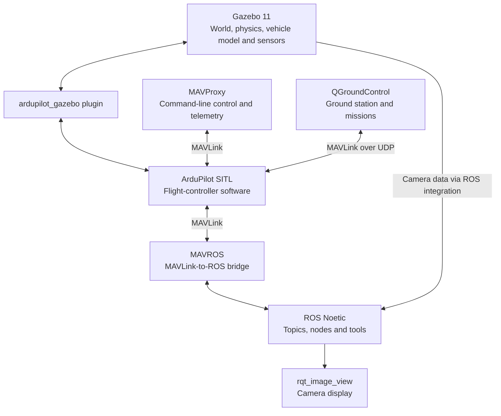

# 02. Understanding the Simulation Stack

Before installing everything, it helps to understand what each tool is responsible for. Otherwise, when a drone refuses to move, the whole setup can feel like one large black box.

We'll use a simple question to keep the pieces straight: **when you type `takeoff 10`, what actually makes the drone rise inside Gazebo?**

The command, flight controller, simulator, and communication layers each have a different job. Once those jobs are clear, the installation order and the troubleshooting steps make much more sense.

> **Scope:** This guide describes the stack used in the rest of this repository: Ubuntu 20.04, ROS Noetic, Gazebo Classic 11, and ArduPilot SITL. These are version-specific instructions for a legacy environment. Do not mix commands from a ROS 2 setup into the ROS Noetic steps.

## The system at a glance

The setup has a few distinct parts:



This is a conceptual map, not a launch script. The exact processes you run and the ports they use are defined in the installation and flight guides.

## 1. Gazebo: the simulated world

[Gazebo Classic](https://classic.gazebosim.org/tutorials) provides the 3D environment in which the drone appears and moves. It simulates the world, physics, collisions, and the sensors attached to a model.

Think of Gazebo as the place where you can see the flight happen. By itself, however, opening a world with a drone model does not mean a flight controller is running or that the drone can respond to flight commands.

In this setup, the main simulation package is `sky_sim`. It provides a ready-made world and a drone model with a camera, so you don't have to create that model and camera integration from scratch.

## 2. ArduPilot SITL: the flight controller without the hardware

SITL stands for **Software-In-The-Loop**. ArduPilot's flight-controller software runs as a program on your computer rather than on a physical flight controller. It receives simulated vehicle and sensor information and calculates how the vehicle should respond.

The official [ArduPilot SITL documentation](https://ardupilot.org/dev/docs/sitl-simulator-software-in-the-loop.html) explains the idea in more depth.

SITL is not the same thing as Gazebo:

- **Gazebo** simulates the world and the physical vehicle behaviour.
- **ArduPilot SITL** runs the flight-control software.

For the two to work together, they need an interface.

## 3. `ardupilot_gazebo`: connecting the simulator and flight controller

The `ardupilot_gazebo` plugin connects Gazebo to ArduPilot SITL. It lets the simulated vehicle state and the flight-controller outputs pass between the two sides.

Without a correctly built and configured plugin, Gazebo and SITL can both be running while the simulated drone still does not respond as expected. That's why the main setup guide tests this connection before adding the camera-equipped `sky_sim` package and the other tools.

A useful rule when troubleshooting is to check the earliest connection that should be working. If the simulator and SITL are not communicating, changing a camera topic or a ground-station setting will not fix the underlying problem.

## 4. MAVLink: the communication protocol

[MAVLink](https://mavlink.io/en/) is the messaging protocol used to exchange commands and telemetry with the flight controller. It is not the simulator and it is not the ground-control application; it is one of the ways those components communicate.

For this guide, two tools use MAVLink in different ways: MAVProxy and QGroundControl. MAVROS also uses MAVLink to connect ROS software to the autopilot.

### MAVProxy

MAVProxy is the command-line ground-control tool used in the setup. It provides a console in which you can enter commands such as:

```text
mode GUIDED
arm throttle
takeoff 10
```

These commands are sent to the simulated flight controller. SITL and the Gazebo plugin then work together to produce the resulting simulated flight.

The guide starts SITL through `sim_vehicle.py`, which also starts MAVProxy as part of the normal workflow. In the later launch instructions, follow the exact command and terminal order shown there rather than mixing commands from different stages.

### QGroundControl

[QGroundControl](https://docs.qgroundcontrol.com/Stable_V4.4/en/qgc-user-guide/) is a graphical ground-control station. It can display telemetry and vehicle status, and it provides tools for planning and uploading waypoint missions.

MAVProxy and QGroundControl are two different interfaces to the vehicle. They can both connect to a SITL instance, but the connection settings must be configured correctly. In the single-drone instructions in this repository, SITL is configured to send MAVLink to UDP port `14550` for QGroundControl.

If QGroundControl does not connect, first check that SITL has reached its ready state and that the output port matches the ground-station listening port. Do not assume that opening QGroundControl alone starts the simulated vehicle.

## 5. ROS Noetic: the robotics middleware

ROS provides a way for separate robotics programs to exchange data and work together. In ROS 1, programs can publish and subscribe to **topics**, and they can use other ROS communication mechanisms when needed.

In this setup, ROS is particularly useful for accessing sensor data, including the simulated drone's camera feed. ROS does not replace ArduPilot as the flight controller, and it does not replace Gazebo as the 3D simulator.

This repository uses **ROS Noetic**, not ROS 2. The commands and package names in the main setup guide are written for ROS Noetic on Ubuntu 20.04.

## 6. MAVROS: bringing MAVLink into ROS

MAVROS bridges MAVLink communication into ROS interfaces, allowing ROS programs to work with autopilot data and commands through ROS topics and services.

It helps to keep the names straight:

- **MAVLink** is the communication protocol.
- **MAVProxy** is a command-line ground-control tool.
- **MAVROS** is a bridge between MAVLink and ROS.

They are related, but they are not interchangeable. MAVROS is part of the broader ROS integration in this environment; not every step in the single-drone flight test requires you to launch a separate MAVROS command.

## 7. `sky_sim` and the camera feed

`sky_sim` is a ROS package used by the setup guide. It contains a ready-made simulation world and a drone model with a camera attached.

The camera data is made available through ROS topics. You can inspect the available camera topics with:

```bash
rostopic list | grep -i cam
```

To view a feed, launch the image viewer:

```bash
rosrun rqt_image_view rqt_image_view
```

Then select the correct camera topic in the viewer. The topic name used by this setup is documented in the flight guide; if you have changed the model or its camera configuration, the name may differ.

One important distinction: launching the `sky_sim` world starts the Gazebo side, but it does **not** start ArduPilot SITL for you. The flight controller must be started separately, in the terminal specified by the guide.

## How the pieces fit during a flight

Here is the sequence in plain language:

1. **Gazebo loads the world and drone model.** The model and its sensors exist in the simulated environment.
2. **ArduPilot SITL starts.** The flight-controller software runs as a process on the computer.
3. **The Gazebo plugin connects the two.** Simulated vehicle information and flight-controller outputs are exchanged.
4. **MAVProxy sends a command.** For example, you can switch to GUIDED mode, arm the simulated vehicle, and command a takeoff.
5. **The simulated flight evolves in Gazebo.** Gazebo displays the vehicle movement while the controller and simulator continue exchanging information.
6. **Other tools receive their own data.** ROS tools can display the camera stream, while QGroundControl can display telemetry and handle waypoint missions if its MAVLink connection is configured.

This is why the installation order matters. You need the software, the connection between the simulator and controller, and then the additional ROS and ground-station integrations.

## Why multiple drones need more than two models

For a multi-drone simulation, duplicating the visible model is only part of the job. Each vehicle needs its own:

- Gazebo model instance;
- ArduPilot SITL instance;
- MAVLink system identity;
- communication configuration; and
- camera topic, if each camera feed is to be accessed separately.

The model name, SITL instance number, MAVLink system ID, and communication port have different purposes. Changing one does not automatically configure the others.

In the configuration documented in this repository, the Gazebo plugin's JSON port must match the intended SITL instance. The multi-drone guide explains the exact model and port configuration. Treat those numbers as part of this particular setup, not as universal port assignments for every ArduPilot simulation.

## A quick troubleshooting map

| Symptom | First thing to check |
|---|---|
| Gazebo opens, but the drone does not respond | Check that ArduPilot SITL is running and the Gazebo plugin is connected correctly. |
| MAVProxy reports that its link is down | Check that SITL started successfully and reached its ready message. |
| QGroundControl stays disconnected | Check the SITL MAVLink output and the UDP listening port. |
| No camera topic appears | Check that the ROS/Gazebo integration is running and that the camera model was loaded. |
| Only one camera topic appears for two drones | Check that each model has a distinct camera topic configured. |
| The second drone moves the wrong model | Recheck the SITL instance-to-model pairing and the plugin's configured JSON port. |

The dedicated troubleshooting guide will cover these cases in more detail.

## What comes next?

Now that the roles of the components are clear, continue to [01. Ubuntu Setup](./01-ubuntu-setup.md) if you still need to prepare the operating system. The installation guide will follow this one and turn the mental model into an ordered setup, with a verification step after each major component.

## References

- [ArduPilot SITL: Software in the Loop](https://ardupilot.org/dev/docs/sitl-simulator-software-in-the-loop.html)
- [MAVLink documentation](https://mavlink.io/en/)
- [Gazebo Classic tutorials](https://classic.gazebosim.org/tutorials)
- [QGroundControl User Guide, stable 4.4](https://docs.qgroundcontrol.com/Stable_V4.4/en/qgc-user-guide/)
